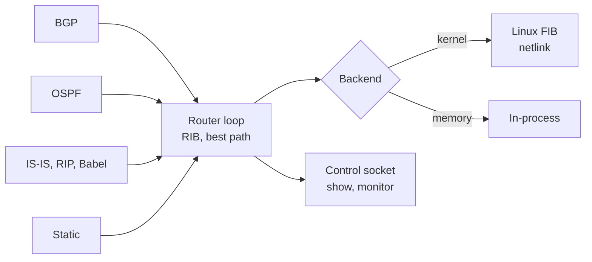

# Wren

<picture>
  <source media="(prefers-color-scheme: dark)" srcset=".github/brand/logo-on-dark.svg">
  
</picture>

Rust routing daemon for BGP, OSPFv2/v3, IS-IS, RIP/RIPng and Babel, with BFD,
VRRP, VRFs and Linux kernel route installation.



## Quickstart

Install Rust through Rustup. Linux is required for kernel routing and live
protocol tests; the core libraries can be tested without it.

```sh
git clone https://github.com/Velstra/wren.git
cd wren
cargo build --release --locked
./target/release/wren check --config examples/wren.toml
```

`check` validates the file without starting protocols or changing routes.
Edit [examples/wren.toml](examples/wren.toml) for your interfaces and peers,
then, on an isolated lab host:

```sh
sudo ./target/release/wren --config examples/wren.toml --backend kernel
```

This opens protocol sockets and changes the kernel routing table. In another
terminal:

```sh
sudo ./target/release/wren show routes
sudo ./target/release/wren show bgp neighbors
sudo ./target/release/wren show ospf neighbors
```

## Test

```sh
cargo fmt --all -- --check
cargo clippy --workspace --all-targets --locked -- -D warnings
cargo test --workspace --locked
bash scripts/run-all-tests.sh   # live exchanges in disposable network namespaces
```

The last line needs `iproute2` and enabled user/network namespaces.
[Fuzzing](fuzz/README.md) is a separate nightly-toolchain workflow.

## Operator handbook

[Build and validate a configuration](https://velstra.github.io/wren/getting-started.html) ·
[Route IPv4 over an IPv6-only link](https://velstra.github.io/wren/protocols/bgp.html#ipv6-transport-true-unnumbered) ·
[Reload BGP peers](https://velstra.github.io/wren/monitoring.html#configuration-hot-reload--sighup) ·
[How Wren selects a route](https://velstra.github.io/wren/architecture.html) ·
[Browse the handbook](https://velstra.github.io/wren/)

## License

`wren-core`: [Apache-2.0](LICENSE-APACHE).
Daemon and other crates: [GPL-2.0-or-later](LICENSE).
Contributions use the same licenses; no CLA is required.
