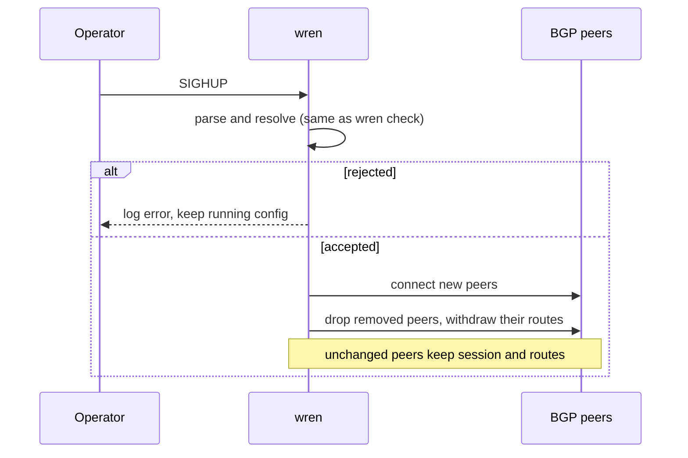

# Inspect routes and reload peers {#monitoring}

## Find the layer where a route disappears {#operational-show-commands}

| Question | Command | Expected evidence |
| --- | --- | --- |
| Is my neighbor up? | `wren show bgp neighbors` | Peer AS and state `Established` |
| Did BGP learn the prefix? | `wren show bgp routes` | Prefix and BGP attributes |
| Did the router select it? | `wren show routes` | Winning route, protocol and next hop |
| Did Linux install it? | `ip -4 route show proto bgp` | Kernel route on the expected interface, when using `--backend kernel` |

For a nondefault control socket, specify its path before the subcommand, for example `wren --socket /tmp/lab.sock show routes`.

## Add or remove a BGP peer on reload {#configuration-hot-reload--sighup}

Wren compares the new neighbor set with the running one. Use this procedure for **adding or removing** peers. A change to an existing peer’s policy, timers, or other settings requires separate validation.



Run the complete three-router lab from a Linux checkout:

```sh
bash scripts/bgp-hot-reload-smoke.sh
```

| Phase | Neighbor B (AS 65002) | Neighbor C (AS 65003) |
| --- | --- | --- |
| Start A with B only | Established; `10.20.0.0/24` learned | Absent |
| Add C and reload | Still Established; route retained | Established; `10.30.0.0/24` learned |
| Remove C and reload | Still Established; route retained | Session removed; its route withdrawn |

On a managed host, check the edited file, then send `SIGHUP` to the daemon that loaded it (its process ID as `WREN_PID`). Inspect the same socket before and after.

```sh
wren check --config /etc/wren/wren.toml
kill -HUP "$WREN_PID"
wren show bgp neighbors
wren show routes
```

A rejected reload leaves the running configuration active. Check the daemon log for parsing or resolution errors. [Complete test and expected conditions](https://github.com/Velstra/wren/blob/main/scripts/bgp-hot-reload-smoke.sh).

## Subscribe to forwarding changes {#streaming-the-forwarding-table--wren-monitor-routes}

```sh
wren monitor routes
```

The initial snapshot ends with `% end-of-dump`. A `+` record installs or replaces a route; a `-` record withdraws a prefix from a table. For example, `- 198.51.100.0/24 table 254` withdraws that prefix from Linux’s main table. Directly connected routes stay with the interface owner.

## Export FlowSpec decisions {#streaming-filter-rules--wren-monitor-flowspec}

```sh
wren show bgp flowspec
wren monitor flowspec
```

The stream carries `action` and `match` fields plus snapshot and withdrawal events. Downstream consumers apply forwarding policy. Actions include `discard`, `rate-limit:<bytes-per-second>` and `mark:<dscp>`. A `none` token means no recognized action. [FlowSpec integration test](https://github.com/Velstra/wren/blob/main/scripts/bgp-flowspec-smoke.sh).

## Collect metrics {#prometheus-metrics}

<a id="scraping-it"></a>

```sh
wren show metrics
```

The Unix socket returns Prometheus exposition text. Inspect `wren_bgp_neighbor_up` by neighbor and ASN and `wren_rib_routes` by protocol. For node_exporter’s textfile collector, write a temporary file in its configured directory and rename it into place after a successful read.

## Stream BGP events to a collector {#bmp--streaming-bgp-state-to-a-monitoring-station}

```toml
[bgp.bmp]
station = "192.0.2.50:11019"
```

Add this table to your BGP configuration. Wren connects to that BMP collector and emits peer-up, route-monitoring and peer-down messages. Reconnection resumes live observations; it does not replay the missed interval. [Collector test](https://github.com/Velstra/wren/blob/main/scripts/bgp-bmp-smoke.sh).
