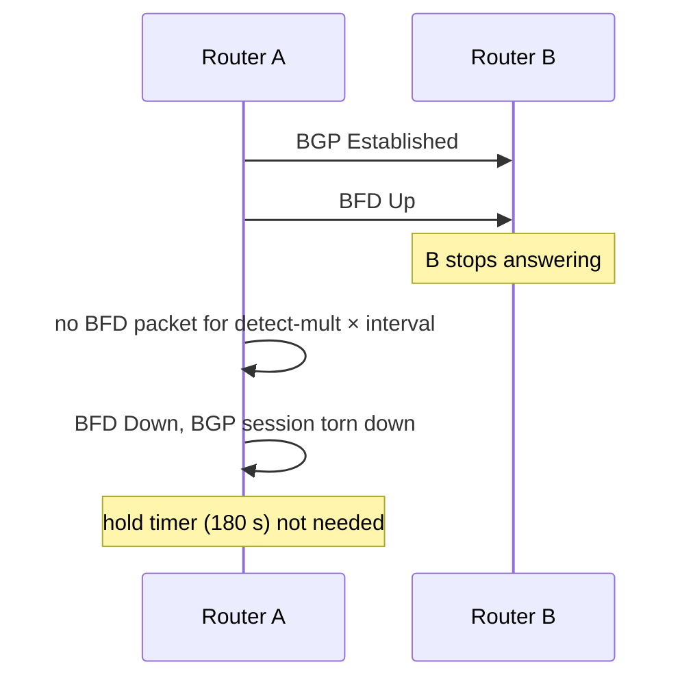

# Detect a failed routing peer with BFD {#bfd}

BFD can tell a routing protocol that its neighbor has failed before the protocol’s own hold timer expires. Check BFD and protocol state separately.

<a id="what-is-implemented"></a>

## Configure the first router {#configuration}

Router A enables BFD on a particular BGP neighbor. The lab uses permissive eBGP policy only inside its disposable namespaces. The BFD intervals are milliseconds; the BGP hold time is seconds.

```toml
router-id = "10.0.0.1"
[bfd]
min-tx      = 200
min-rx      = 200
detect-mult = 3
[bgp]
enabled             = true
local-as            = 65001
hold-time           = 180
ebgp-require-policy = false
[[bgp.neighbor]]
address   = "10.0.0.2"
remote-as = 65002
bfd       = true
```


## Observe the result {#operational-view}

```sh
bash scripts/bgp-bfd-smoke.sh
```

On a separate running instance, inspect the same state:

```sh
wren show bfd
wren show bgp neighbors
```



The fixture waits for BFD `Up` and BGP `Established`, then checks that loss of BFD tears down BGP before its 180-second hold timer. Detection depends on the negotiated intervals and multiplier.

[Lab source](https://github.com/Velstra/wren/blob/main/scripts/bgp-bfd-smoke.sh).

<a id="per-neighbour-keys"></a>
<a id="echo-rfc-5880-64"></a>

## Authentication and echo {#authentication-rfc-5880-67}

The [per-session authentication test](https://github.com/Velstra/wren/blob/main/scripts/bfd-auth-per-session-smoke.sh) configures peers independently. To check packet return on the data path, start with the [IPv4 echo](https://github.com/Velstra/wren/blob/main/scripts/bfd-echo-smoke.sh) or [IPv6 echo](https://github.com/Velstra/wren/blob/main/scripts/bfd-echo-v6-smoke.sh) example.
