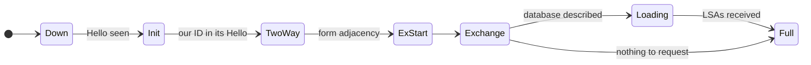

# OSPFv2 on a point-to-point link {#ospfv2}

Use OSPFv2 to advertise IPv4 routes inside an area. The first checkpoint is a Full adjacency; the link-state database and the Linux route table answer different questions.

<a id="topologies-that-work-today"></a>

## Configure the first router {#configuration}

This is router A on the test veth pair. Router B uses its own router ID, the interface on the opposite end, and the same network type and area.

```toml
router-id = "10.0.0.1"
[ospf]
enabled = true
interfaces = ["veth0"]
network-type = "point-to-point"
```

<a id="testing-it"></a>

## Observe the result {#inspecting-it}

```sh
bash scripts/ospf-show-smoke.sh
```

On a separate running instance, inspect the same state:

```sh
wren show ospf neighbors
wren show ospf interfaces
wren show ospf database
```

The lab runs its own queries before cleanup and checks for the neighbor in `Full` state and the interface in `PtP` state. `wren show ospf neighbors` steps through the RFC 2328 states on the way:



[Lab source](https://github.com/Velstra/wren/blob/main/scripts/ospf-show-smoke.sh).

<a id="stub-areas-rfc-2328-36"></a>
<a id="nssa-areas-rfc-3101"></a>
<a id="totally-stubby-and-totally-nssa-areas"></a>
<a id="injecting-a-default-into-a-plain-nssa-rfc-3101-23"></a>

## Choose an area type {#what-is-implemented}

Stub areas suppress external LSAs. An NSSA may originate local externals as type 7. An ABR can inject a default into a plain NSSA. Use the [stub](https://github.com/Velstra/wren/blob/main/scripts/ospf-stub-area-smoke.sh), [NSSA default](https://github.com/Velstra/wren/blob/main/scripts/ospf-nssa-default-smoke.sh), or [totally stubby](https://github.com/Velstra/wren/blob/main/scripts/ospf-totally-stubby-smoke.sh) lab to check what each router learns.

<a id="authentication-rfc-2328-d"></a>
<a id="not-yet-implemented"></a>

## Redistribution and authentication {#redistribution-from-the-rib}

Configure redistribution deliberately on the ASBR and inspect the receiving router’s database. Separate regression cases cover [redistribution](https://github.com/Velstra/wren/blob/main/scripts/ospf-redistribute-smoke.sh) and [authentication](https://github.com/Velstra/wren/blob/main/scripts/ospf-auth-smoke.sh). Review the [coverage notes](../roadmap.md) before relying on an optional extension.
