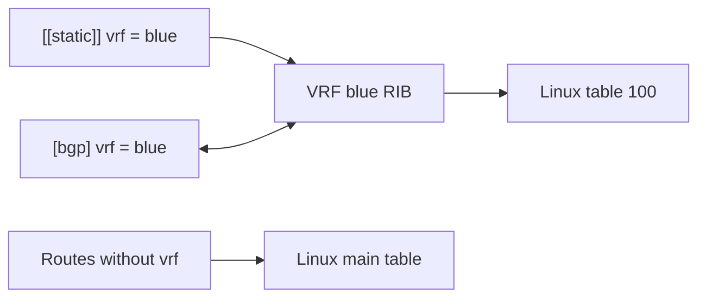

# Separate tenant routes with VRFs {#vrfs--route-distinguishers}

A named VRF directs selected routes into a dedicated Linux table. A BGP instance bound to it uses the VRF’s routing domain for its session as well.




## Configure the first router {#configuration}

This fixture uses a Linux VRF master named blue and table 100. The test script creates the Linux devices. The Wren TOML binds BGP and a static prefix to that domain; its permissive eBGP policy is limited to the isolated lab.

```toml
router-id = "10.0.0.1"
[[vrf]]
name  = "blue"
table = 100
[[static]]
prefix = "10.99.0.0/24"
via    = "10.9.0.100"
vrf    = "blue"
[bgp]
enabled             = true
local-as            = 65001
vrf                 = "blue"
redistribute        = ["static"]
ebgp-require-policy = false
[[bgp.neighbor]]
address   = "10.9.0.2"
remote-as = 65002
```


## Observe the result {#operational-view}

```sh
bash scripts/vrf-bgp-smoke.sh
```

On a separate running instance, inspect the same state:

```sh
ip route show table 100
wren show routes
```

The receiving router learns `10.99.0.0/24 via 10.9.0.1` in table 100. The same prefix is absent from the main table.

[Lab source](https://github.com/Velstra/wren/blob/main/scripts/vrf-bgp-smoke.sh).

<a id="route-maps"></a>

## Distinguish table selection from route policy {#route-distinguishers}

The Linux table number selects a forwarding domain. A route distinguisher identifies a route in VPN-related contexts. VRF import and export route-maps decide what enters the VRF RIB or reaches the FIB. [Static table isolation and route-map example](https://github.com/Velstra/wren/blob/main/scripts/vrf-smoke.sh).
