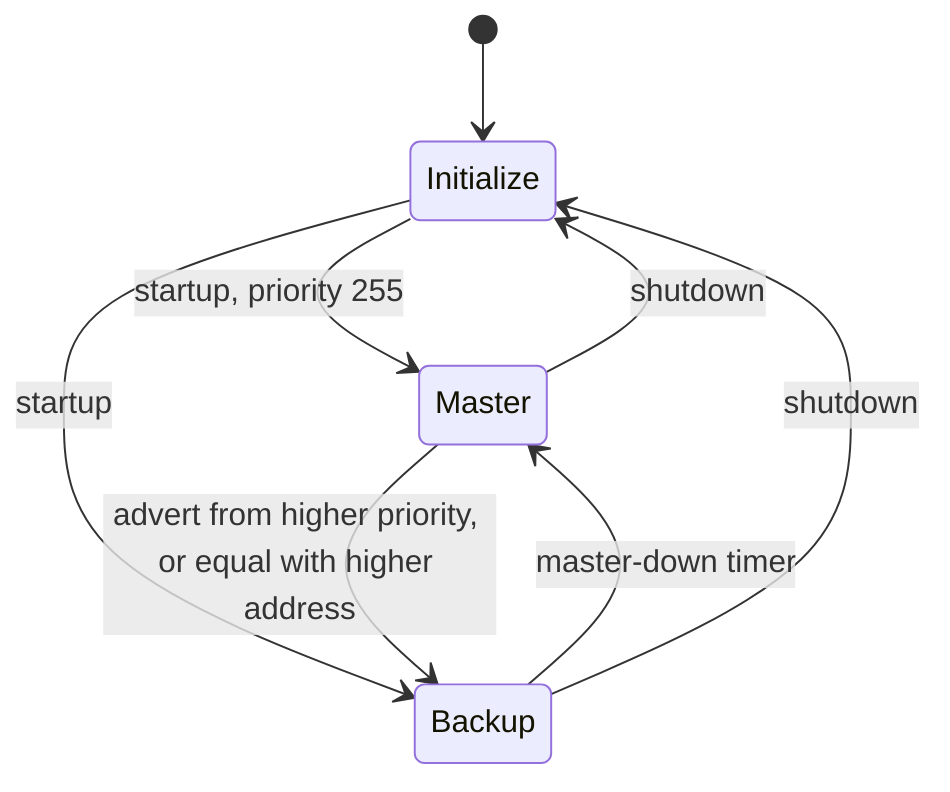

# Move a gateway address between two routers {#vrrp--first-hop-redundancy-rfc-5798}

VRRP peers share a virtual router ID and virtual IP. During failover, verify the address on the interface as well as the router role.

<a id="how-it-works"></a>



A new master assumes the virtual address and announces it (gratuitous ARP for IPv4, unsolicited neighbor advertisement for IPv6). `wren show vrrp` prints the state.

## Configure the first router {#configuration}

The lab configures priority 200 on router A. Router B uses the same VRID and virtual address with a lower priority.

```toml
router-id = "10.0.0.1"
[[vrrp]]
interface       = "veth0"
vrid            = 51
priority        = 200
advert-interval = 300
virtual-address = ["10.0.0.254"]
prefix-length   = 24
```


## Observe the result {#operational-view}

```sh
bash scripts/vrrp-smoke.sh
```

On a separate running instance, inspect the same state:

```sh
wren show vrrp
ip -4 addr show dev veth0
```

The fixture checks that only A holds `10.0.0.254` initially, then checks that B assumes the address after A stops.

[Lab source](https://github.com/Velstra/wren/blob/main/scripts/vrrp-smoke.sh).

<a id="electing-on-one-link-serving-on-another"></a>
<a id="scope"></a>

## Track the right link {#tracking-an-uplink}

Use the [uplink tracking lab](https://github.com/Velstra/wren/blob/main/scripts/vrrp-track-smoke.sh) to lower effective priority when a tracked interface fails. With `address-interface`, elections can run on a separate interface from the VIP. The [address ownership test](https://github.com/Velstra/wren/blob/main/scripts/vrrp-ha-smoke.sh) exercises removal and recreation of the serving link.


## Appliance forwarding authority {#appliance-ha-witness-or-explicit-two-node-mode}

VRRP manages address ownership. Sentinel can additionally gate forwarding on a lease from an independent witness. Its explicit two-node mode has different partition guarantees: two isolated members cannot distinguish peer failure from loss of every control path. Use the [Sentinel operator handbook](https://velstra.github.io/sentinel/) for appliance enrollment and failover procedures.
